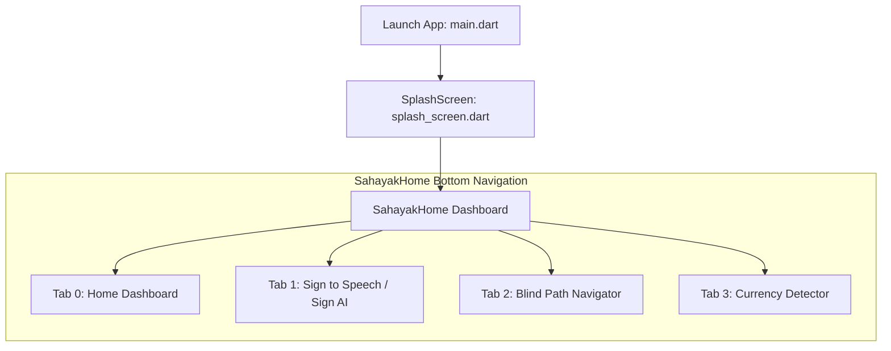
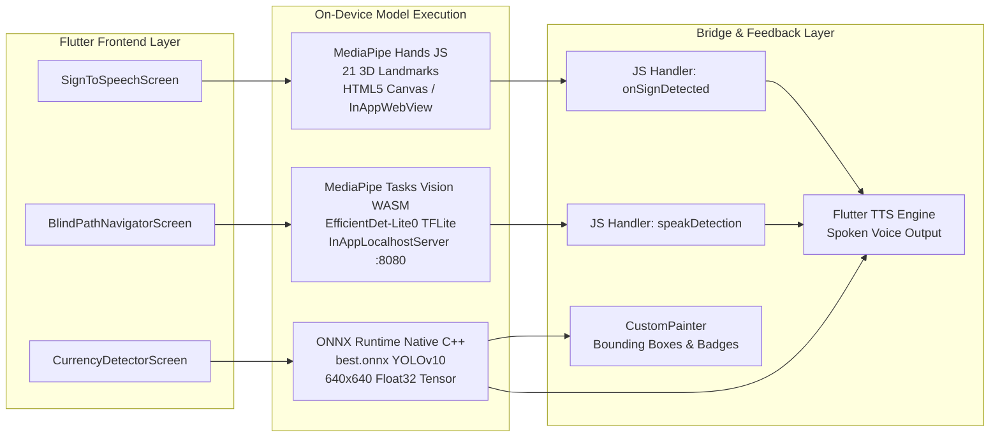

# Sahayak (सहायक)
### Assistive Multi-Modal AI Suite for the Visually & Hearing Impaired

[](https://github.com/PresenceOP-Coder/Sai_Sahayak)
[](https://flutter.dev)
[](https://dart.dev)
[](https://onnxruntime.ai)
[](https://developers.google.com/mediapipe)
[](https://fastapi.tiangolo.com)
[](LICENSE)

---

## 📖 Table of Contents

- [1. Executive Summary](#1-executive-summary)
- [2. End-to-End System Architecture](#2-end-to-end-system-architecture)
  - [Application Navigation Flow](#application-navigation-flow)
  - [Edge AI Reality vs Cloud Backend](#edge-ai-reality-vs-cloud-backend)
  - [Architectural Flowchart](#architectural-flowchart)
- [3. Deep-Dive Feature Breakdown](#3-deep-dive-feature-breakdown)
  - [Feature 1: 🤟 Sign Language Translator (Sign AI)](#feature-1--sign-language-translator-sign-ai)
  - [Feature 2: 🦯 Blind Path Navigator (Spatial Obstacle Detection)](#feature-2--blind-path-navigator-spatial-obstacle-detection)
  - [Feature 3: 💵 Offline Indian Rupee Currency Detector](#feature-3--offline-indian-rupee-currency-detector)
- [4. Repository & Codebase Map](#4-repository--codebase-map)
- [5. Getting Started & Installation](#5-getting-started--installation)
  - [Frontend Setup (Flutter Mobile & Web)](#frontend-setup-flutter-mobile--web)
  - [Backend Setup (FastAPI & WebSockets)](#backend-setup-fastapi--websockets)
- [6. Verification & Testing](#6-verification--testing)
  - [Frontend Analysis](#frontend-analysis)
  - [Backend Offline Regression & WebSocket Tests](#backend-offline-regression--websocket-tests)
- [7. Troubleshooting Guide](#7-troubleshooting-guide)
- [8. Contributing & License](#8-contributing--license)

---

## 1. Executive Summary

**Sai Sahayak** (*सहायक* — meaning *Companion / Helper*) is a multi-modal assistive application built with **Flutter**, designed to bridge critical independence and communication barriers for individuals with physical disabilities:

1. **For the Deaf & Mute**: Translates real-time hand gestures into conversational speech and live on-screen text.
2. **For the Visually Impaired**: Scans walking paths, detects obstacles, calculates direction (left/center/right) and proximity, and delivers spoken directional navigation instructions.
3. **For Financial Independence**: Scans Indian Rupee banknotes (₹5 to ₹500) using a native on-device **YOLOv10** neural network and speaks denominations aloud without requiring internet connectivity.

### The Architectural Philosophy: Edge AI First
Assistive applications used outdoors, in public markets, or on transit cannot rely on constant internet connectivity. Cloud video streaming also creates latency and exposes private camera feeds. **Sai Sahayak** addresses this by running computer vision models directly **on-device** using **ONNX Runtime** and **WebAssembly**, achieving sub-100ms inference with zero server dependency and 100% data privacy.

---

## 2. End-to-End System Architecture

### Application Navigation Flow
The application launches directly into the assistive dashboard, providing immediate access to all on-device vision engines:



### Edge AI Reality vs Cloud Backend

| Dimension | Edge AI Pipeline (Active App) | Cloud Backend (`backend/`) |
| :--- | :--- | :--- |
| **Execution Environment** | Client-side on mobile device (Zero server needed) | FastAPI Python server on cloud/local port 5000 |
| **Sign AI Engine** | MediaPipe Hands (21 3D landmarks) + Bitmask heuristics | 16-frame video window $\rightarrow$ Swin3D-S Transformer |
| **Obstacle Detection** | EfficientDet-Lite0 via MediaPipe Tasks Vision WASM | Not part of initial cloud backend |
| **Currency Detection** | YOLOv10 ONNX model via native ONNX Runtime C++ | Not part of initial cloud backend |
| **Latency** | **~40 ms – 120 ms** (Instantaneous) | ~250 ms – 800 ms (Network dependent) |
| **Internet Dependency** | **100% Offline Capable** | Requires high-speed Wi-Fi / 4G / 5G |
| **User Privacy** | Frames processed in RAM; never leaves device | Video frames transmitted over network |

### Architectural Flowchart



---

## 3. Deep-Dive Feature Breakdown

### Feature 1: 🤟 Sign Language Translator (Sign AI)
* **Screen**: `SignToSpeechScreen` (`frontend/lib/features/sign/ui.dart`)
* **Engine**: `frontend/assets/index.html` rendered inside `InAppWebView`
* **Underlying Model**: Google MediaPipe Hands (`@mediapipe/hands`)

```
        8 (Index Tip)    12 (Middle Tip)   16 (Ring Tip)   20 (Pinky Tip)
           |                |                 |               |
        7 (DIP)          11 (DIP)          15 (DIP)        19 (DIP)
           |                |                 |               |
        6 (PIP)          10 (PIP)          14 (PIP)        18 (PIP)
           \                |                 |               /
        5 (MCP) --------- 9 (MCP) -------- 13 (MCP) ------ 17 (MCP)
           \                                                 /
            4 (Thumb Tip)                                   /
             \                                             /
              3 (Thumb IP)                                /
               \                                         /
                2 (Thumb MCP)                           /
                 \                                     /
                  1 (Thumb CMC) ---------------------- 0 (Wrist)
```

#### How it Works:
1. **21 3D Landmark Tracking**: Extracts 3D spatial coordinates $(X, Y, Z)$ for all joints in real time.
2. **Finger Extension Bitmask (`f`)**: Evaluates whether each finger tip is extended relative to its PIP joint ($y_{\text{tip}} < y_{\text{pip}}$ in 2D screen coordinates).
3. **Thumb Extension Heuristic**: Computes Euclidean distance from thumb tip (landmark 4) to pinky MCP base (landmark 17) relative to the thumb IP joint:
   $$\text{thumbOpen} = \text{hypot}(x_4 - x_{17}, y_4 - y_{17}) > \text{hypot}(x_3 - x_{17}, y_3 - y_{17}) \times 1.05$$
4. **15 Conversational Gestures**: Maps bitmasks to phrases:
   - `[1, 1, 1, 1]` + Open Thumb $\rightarrow$ *"Hello! Nice to meet you."* (Open Palm)
   - `[0, 0, 0, 0]` + Closed Thumb $\rightarrow$ *"Yes, I agree."* (Fist)
   - `[0, 0, 0, 0]` + Open Thumb $\rightarrow$ *"Everything is good."* (Thumbs Up)
   - `[1, 0, 0, 0]` + Closed Thumb $\rightarrow$ *"Excuse me, I need assistance."* (Pointing Up)
   - `[1, 0, 0, 0]` + Open Thumb $\rightarrow$ *"Wait a moment, please."*
   - `[1, 1, 0, 0]` + Closed Thumb $\rightarrow$ *"Thank you very much."* (Peace / V-sign)
   - `[1, 1, 0, 0]` + Open Thumb $\rightarrow$ *"Where is the nearest exit?"*
   - `[1, 1, 1, 0]` + Closed Thumb $\rightarrow$ *"Water, please."* (Three Fingers)
   - `[1, 1, 1, 0]` + Open Thumb $\rightarrow$ *"I am feeling hungry."*
   - `[0, 1, 1, 1]` $\rightarrow$ *"Okay, I understand."* (OK sign)
   - `[1, 0, 0, 1]` + Open Thumb $\rightarrow$ *"I love you."* (ILY sign)
   - `[1, 0, 0, 1]` + Closed Thumb $\rightarrow$ *"No, thank you."* (Rock/Horns Sign)
   - `[0, 0, 0, 1]` + Open Thumb $\rightarrow$ *"Please call or text me."* (Call Sign)
   - `[0, 0, 0, 1]` + Closed Thumb $\rightarrow$ *"Where is the restroom?"* (Pinky Up)
5. **1000ms Temporal Hold Barrier**: Enforces a 1-second hold duration to eliminate transition jitter and accidental gestures.
6. **Voice Synthesis**: Emits JavaScript callback `onSignDetected` to Flutter, which triggers `flutter_tts` speech output.

---

### Feature 2: 🦯 Blind Path Navigator (Spatial Obstacle Detection)
* **Screen**: `BlindPathNavigatorScreen` (`frontend/lib/features/object/ui.dart`)
* **Host Engine**: `InAppLocalhostServer` serving `http://localhost:8080/index2.html`
* **Underlying Model**: Google **EfficientDet-Lite0** (~4.4 MB) running via **MediaPipe Tasks Vision WebAssembly**

#### How it Works:
1. **Sub-100ms Inference Loop**: Executes every **180 ms** (~5.5 FPS) to balance real-time responsiveness with battery preservation and thermal stability.
2. **Spatial Zone Classification**: Computes horizontal bounding box center $\text{ratio} = \frac{x + w/2}{\text{frameWidth}}$:
   - **Left Corridor ($\text{ratio} < 0.36$)**: e.g., *"Person on your left"*
   - **Direct Walking Path ($0.36 \le \text{ratio} \le 0.64$)**: e.g., *"Chair directly ahead"*
   - **Right Corridor ($\text{ratio} > 0.64$)**: e.g., *"Door on your right"*
3. **Proximity & Emergency Collision Estimation**: Approximates obstacle distance using perspective area ratio:
   $$\text{AreaRatio} = \frac{w \times h}{\text{frameWidth} \times \text{frameHeight}}$$
   If $\text{AreaRatio} > 0.18$ in the center corridor, an emergency warning is triggered:
   *"Warning: [Object] directly ahead, very close!"*
4. **Auditory Throttling**: A 2800ms cooldown prevents audio fatigue, while emergency warnings interrupt pending speech immediately.

---

### Feature 3: 💵 Offline Indian Rupee Currency Detector
* **Screen**: `CurrencyDetectorScreen` (`frontend/lib/features/currency/screens/currency_detector_screen.dart`)
* **Service**: `CurrencyDetectorService` (`frontend/lib/features/currency/services/currency_detector_service.dart`)
* **Runtime**: Native C++ `flutter_onnxruntime` with `onnxruntime-web` WebAssembly fallback
* **Model Asset**: Fine-tuned **YOLOv10** exported to ONNX: `frontend/assets/models/best.onnx` (8.9 MB)

#### Denominations Supported:
| Denomination | Model Class Key | Audio Output |
| :---: | :--- | :--- |
| **₹5** | `5IndianRupees` | *"5 Rupees detected"* |
| **₹10** | `10IndianRupees` | *"10 Rupees detected"* |
| **₹20** | `20IndianRupees` | *"20 Rupees detected"* |
| **₹50** | `50IndianRupees` | *"50 Rupees detected"* |
| **₹100** | `100IndianRupees` | *"100 Rupees detected"* |
| **₹200** | `200IndianRupees` | *"200 Rupees detected"* |
| **₹500** | `500IndianRupees` | *"500 Rupees detected"* |

#### Tensor Transformation Pipeline:
1. **Bilinear Resizing**: Rescales input images to **$640 \times 640$**.
2. **Planar $NCHW$ Conversion**: Converts standard interleaved $HWC$ ($RGBRGB...$) into contiguous planar Float32 format ($[1, 3, 640, 640]$), normalized to $[0.0, 1.0]$:
   ```dart
   final floatList = Float32List(1 * 3 * 640 * 640);
   final area = 640 * 640;
   for (int y = 0; y < 640; y++) {
     for (int x = 0; x < 640; x++) {
       final pixel = resized.getPixel(x, y);
       final index = y * 640 + x;
       floatList[index]            = pixel.r / 255.0; // Channel 0: Red
       floatList[area + index]     = pixel.g / 255.0; // Channel 1: Green
       floatList[2 * area + index] = pixel.b / 255.0; // Channel 2: Blue
     }
   }
   ```
3. **Output Tensor Parsing $[1, 11, 8400]$**:
   - **8,400 Candidate Predictions**: Spans the 3 feature pyramid levels ($80\times80 + 40\times40 + 20\times20 = 8400$).
   - **11 Attributes per Anchor**: 4 coordinates $(cx, cy, w, h)$ + 7 denomination confidence scores.
4. **Visual & Auditory Feedback**:
   - `CurrencyBoundingBoxPainter` draws a neon-green box (`#00E676`) with class badge (e.g., `₹500 96%`).
   - Speaks: *"500 Rupees detected with 96 percent confidence"*.
   - Displays real-time inference latency (e.g., `⚡ 68 ms`).

---

## 4. Repository & Codebase Map

```text
Sai_Sahayak/
├── frontend/                     # Flutter cross-platform client
│   ├── assets/
│   │   ├── env.json              # Local client environment config
│   │   ├── index.html            # MediaPipe Hands & Sign AI engine
│   │   ├── index2.html           # MediaPipe Tasks Vision WASM path navigator
│   │   └── models/
│   │       └── best.onnx         # Offline YOLOv10n Indian Rupee ONNX model (8.9 MB)
│   ├── lib/
│   │   ├── core/config/          # AppConfig and environment fallback constants
│   │   ├── features/
│   │   │   ├── currency/         # Native ONNX Currency Detection suite
│   │   │   │   ├── models/       # CurrencyDetection entity & denomination formatters
│   │   │   │   ├── screens/      # Camera/gallery detector screen with diagnostics
│   │   │   │   ├── services/     # In-memory preprocessing, NCHW conversion & parsing
│   │   │   │   └── widgets/      # Bounding box & confidence badge painter
│   │   │   ├── home/             # SahayakHome bottom nav & assistive tool cards
│   │   │   ├── object/           # BlindPathNavigatorScreen & InAppLocalhostServer
│   │   │   ├── settings/         # App preferences, TTS rate, volume & offline info
│   │   │   ├── sign/             # SignToSpeechScreen hosting MediaPipe WebView
│   │   │   └── splash/           # Animated splash entrypoint
│   │   └── main.dart             # Application root, ScreenUtilInit & Provider setup
│   ├── web/                      # Web platform shell & ONNX Runtime Web engine
│   ├── frontend_guide.md         # Detailed Flutter development & build guide
│   └── pubspec.yaml              # Dependencies and asset declarations
│
├── backend/                      # Optional FastAPI & WebSocket cloud backend
│   ├── app/                      # FastAPI application routes & services
│   ├── docs/
│   │   └── backend_run_guide.md  # Detailed backend execution guide
│   ├── tests/                    # 150+ regression & WebSocket test suites
│   ├── pyproject.toml            # Backend dependencies
│   └── uv.lock                   # Pinned dependency lockfile
│
├── guide.md                      # Project Architecture & Technical Guide
└── README.md                     # Project documentation
```

---

## 5. Getting Started & Installation

### Prerequisites

| Tool | Minimum Version | Installation Link |
| :--- | :--- | :--- |
| **Flutter SDK** | 3.19+ | [Install Flutter](https://docs.flutter.dev/get-started/install) |
| **Dart SDK** | 3.3+ (bundled with Flutter) | — |
| **Python** | 3.10 / 3.11 / 3.12 | [Python Downloads](https://www.python.org/downloads/) |
| **uv** (Recommended) | Latest | [Install uv](https://github.com/astral-sh/uv) |
| **Platform Tools** | Android Studio / Xcode / Chrome | — |

---

### Frontend Setup (Flutter Mobile & Web)

1. **Navigate to the frontend directory**:
   ```bash
   cd frontend
   ```

2. **Install Flutter packages**:
   ```bash
   flutter pub get
   ```

3. **Run the Application**:
   - **On Connected Android / iOS Device or Emulator**:
     ```bash
     flutter run
     ```
   - **On Web (Google Chrome)**:
     ```bash
     flutter run -d chrome
     ```
   - **Build Release APK**:
     ```bash
     flutter build apk --release
     ```

4. **Permissions**:
   The app requests `Camera` and `Microphone` access on launch. Ensure permissions are granted.

---

### Backend Setup (FastAPI & WebSockets)

*(Optional: only needed if experimenting with the cloud Swin3D-S recognition pipeline)*

1. **Navigate to the backend directory**:
   ```bash
   cd backend
   ```

2. **Set up Python Environment & Install Dependencies**:
   ```bash
   uv sync
   # Or using pip:
   python -m venv venv
   source venv/bin/activate
   pip install -r requirements.txt
   ```

3. **Start the Server**:
   ```bash
   uv run uvicorn app.main:app --host 127.0.0.1 --port 5000 --reload
   ```
   - REST API: `http://127.0.0.1:5000/`
   - WebSocket SLT: `ws://127.0.0.1:5000/ws`

---

## 6. Verification & Testing

### Frontend Analysis
Verify that all Dart sources, providers, and assets analyze with zero errors:
```bash
cd frontend
flutter analyze
```
*(Result: **No issues found!**)*

### Backend Offline Regression & WebSocket Tests
Run the deterministic backend unit and regression test suite:
```bash
cd backend
python -m unittest discover -s tests/regression -v
```

Run the end-to-end WebSocket streaming pipeline test:
```bash
cd backend
python tests/test_websockets_api.py
```

---

## 7. Troubleshooting Guide

| Issue | Cause | Solution |
| :--- | :--- | :--- |
| **`Image.file is not supported on Flutter Web`** | Using file paths instead of raw memory bytes on web | The app uses `Uint8List` and `Image.memory` across all platforms. Ensure you pull the latest `main`. |
| **`ONNX session load error on Web`** | Missing ONNX Runtime JavaScript engine | Verified included in `web/index.html` via CDN (`ort.min.js`). Ensure internet connectivity on initial web load. |
| **Camera permission denied** | OS permission not granted | Open Device Settings $\rightarrow$ Apps $\rightarrow$ Sahayak $\rightarrow$ Permissions and grant Camera and Microphone access. |
| **Android Emulator cannot reach backend** | Connecting to `127.0.0.1` instead of Android loopback | Use `http://10.0.2.2:5000` when running inside the Android emulator. |
| **Audio / TTS is silent** | Device volume or silent mode enabled | Ensure device media volume is up and silent/vibrate switch is disabled. |

---

## 8. Contributing & License

Contributions are welcome! Please feel free to submit a pull request or open an issue.

1. Fork the Project
2. Create your Feature Branch (`git checkout -b feature/AmazingFeature`)
3. Commit your Changes (`git commit -m 'feat: Add some AmazingFeature'`)
4. Push to the Branch (`git push origin feature/AmazingFeature`)
5. Open a Pull Request

### License
This project is licensed under the **MIT License** — see the [LICENSE](LICENSE) file for details.
