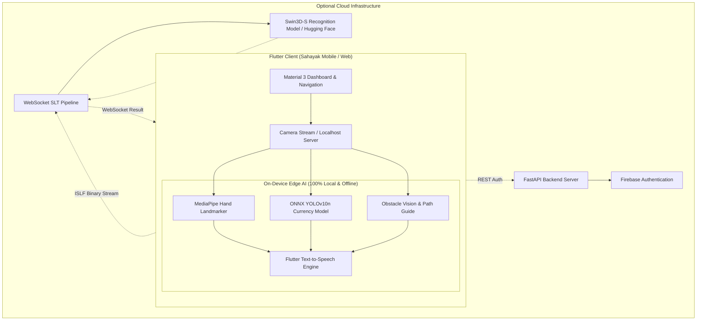

# Sahayak (सहायक) — Smart Accessibility & Assistive AI Suite

A unified, real-time **Assistive AI system** designed to empower deaf, mute, and visually impaired individuals. **Sahayak** brings together on-device **Sign-to-Speech translation**, computer-vision **Blind Path Navigation**, and offline **Indian Rupee Currency Detection** into an accessible, privacy-first Flutter application backed by an optional FastAPI cloud recognition service.

[](https://github.com/PresenceOP-Coder/Sai_Sahayak)
[](https://flutter.dev)
[](https://onnxruntime.ai)
[](https://developers.google.com/mediapipe)
[](https://fastapi.tiangolo.com)
[](LICENSE)

---

## 📌 Table of Contents

- [Overview](#overview)
- [Key Features](#key-features)
  - [1. 🤟 Sign-to-Speech (Sign AI)](#1--sign-to-speech-sign-ai)
  - [2. 🦯 Blind Path Navigator](#2--blind-path-navigator)
  - [3. 💵 Offline Indian Rupee Currency Detector](#3--offline-indian-rupee-currency-detector)
  - [4. 🔒 Privacy-First On-Device Vision](#4--privacy-first-on-device-vision)
  - [5. 🌐 Extended Cloud Recognition Pipeline (Optional)](#5--extended-cloud-recognition-pipeline-optional)
- [System Architecture](#system-architecture)
- [Models & AI Specifications](#models--ai-specifications)
- [Repository Structure](#repository-structure)
- [Getting Started](#getting-started)
  - [Frontend Setup (Flutter)](#frontend-setup-flutter)
  - [Backend Setup (FastAPI & WebSocket)](#backend-setup-fastapi--websocket)
- [Testing](#testing)
  - [Flutter Health & Analysis](#flutter-health--analysis)
  - [Backend Regression & WebSocket Tests](#backend-regression--websocket-tests)
- [Configuration & Environment](#configuration--environment)
- [Troubleshooting](#troubleshooting)
- [Contributing](#contributing)
- [License & Acknowledgments](#license--acknowledgments)

---

## Overview

**Sahayak** (meaning *Helper* / *Companion*) addresses multiple critical everyday accessibility barriers in a single cohesive platform:

1. **For the Deaf & Mute Community**: Bridges the communication gap with hearing individuals by translating hand gestures into spoken voice and live text captions in real time.
2. **For the Visually Impaired Community**: Provides situational awareness, detecting everyday obstacles and announcing directional path navigation cues through spoken audio.
3. **For Financial Independence**: Enables visually impaired individuals to identify Indian currency notes instantly without requiring internet connectivity or cloud latency.

---

## Key Features

### 1. 🤟 Sign-to-Speech (Sign AI)
- **Real-Time Hand Landmark Tracking**: Powered by MediaPipe Hands, tracking 21 key landmarks per hand with zero cloud lag.
- **Dynamic Sign Recognition**: Detects everyday gestures (greetings, responses, emergency phrases) with hold-duration detection and continuous smoothing.
- **Voice Synthesis**: Automatically announces translations aloud using `flutter_tts` so people nearby can hear what is being signed without reading the screen.

### 2. 🦯 Blind Path Navigator
- **Live Obstacle Detection**: Identifies nearby obstacles, furniture, people, stairs, and doors using real-time computer vision.
- **Spatial Audio Guidance**: Translates detected bounding boxes and proximity into clear spoken navigation cues (e.g., *"Obstacle ahead, path clear to your left"*).
- **Accessible UI**: Designed with high-contrast Material 3 surfaces, audible feedback, and audio-first operation.

### 3. 💵 Offline Indian Rupee Currency Detector
- **On-Device YOLOv10n Model**: Runs a fine-tuned ONNX model (`assets/models/best.onnx`) directly inside the app using `flutter_onnxruntime`.
- **7 Denomination Classes**: Detects and classifies **₹5, ₹10, ₹20, ₹50, ₹100, ₹200, and ₹500** notes.
- **Instant Spoken Readout**: Speaks the denomination and confidence level immediately upon detection (e.g., *"₹500 detected with 96 percent confidence"*).
- **Zero Internet Requirement**: Operates 100% offline, guaranteeing availability in markets, public transit, and remote areas.

### 4. 🔒 Privacy-First On-Device Vision
- Camera frames, obstacle bounding boxes, and currency inference passes are computed locally on the user's device.
- No live video feeds or personal camera streams are uploaded to external cloud servers, guaranteeing absolute privacy and maximum responsiveness.

### 5. 🌐 Extended Cloud Recognition Pipeline (Optional)
- **Swin3D-S Video Transformer**: Includes a fine-tuned video backbone (pretrained on Kinetics-400) capable of classifying **76 Indian Sign Language (ISL) word classes** with **66.84% Top-1 accuracy**.
- **FastAPI & WebSocket Streaming**: Low-latency video frame streaming via custom binary `ISLF` JPEG container protocol for high-performance remote server inference.
- **Firebase Auth**: Secure user authentication and cloud synchronization for account profiles.

---

## System Architecture



---

## Models & AI Specifications

### 1. Currency Detector (YOLOv10n ONNX)
- **Model File**: `frontend/assets/models/best.onnx`
- **Architecture**: YOLOv10 Nano optimized for real-time mobile inference
- **Input Tensor**: `[1, 3, 640, 640]` Planar RGB, normalized $[0.0, 1.0]$
- **Output Tensor**: `[1, 8400, 11]` (Normalized bounding boxes $[x, y, w, h]$ + 7 class confidence scores)
- **Supported Classes**:
  | Class Name | Display | Spoken Announcement |
  | :--- | :---: | :--- |
  | `5IndianRupees` | ₹5 | "5 Rupees detected" |
  | `10IndianRupees` | ₹10 | "10 Rupees detected" |
  | `20IndianRupees` | ₹20 | "20 Rupees detected" |
  | `50IndianRupees` | ₹50 | "50 Rupees detected" |
  | `100IndianRupees` | ₹100 | "100 Rupees detected" |
  | `200IndianRupees` | ₹200 | "200 Rupees detected" |
  | `500IndianRupees` | ₹500 | "500 Rupees detected" |
- **Inference Runtime**: `flutter_onnxruntime` with native hardware acceleration and `onnxruntime-web` WebAssembly fallback.

### 2. ISL Swin3D-S Video Recognition (Cloud Model)
- **Architecture**: Video Swin Transformer Small (`Swin3D-S`)
- **Pretraining**: Kinetics-400
- **Fine-tuned Classes**: 76 Indian Sign Language word classes
- **Input**: 16-frame temporal video clip ($16 \times 224 \times 224$)
- **Accuracy**: **66.84% Top-1 Accuracy**, Macro F1: **0.638**, Weighted F1: **0.648**
- **Hosting**: Hugging Face Spaces (`Creator-090/isl-swin3d-model`)

---

## Repository Structure

```text
Sai_Sahayak/
├── frontend/                     # Flutter cross-platform client
│   ├── assets/
│   │   ├── env.json              # Client environment config
│   │   ├── index.html            # MediaPipe Hand tracking & Sign AI engine
│   │   ├── index2.html           # Obstacle detection & path navigator engine
│   │   └── models/
│   │       └── best.onnx         # Offline YOLOv10n Indian Rupee ONNX model
│   ├── lib/
│   │   ├── core/                 # Config, frame converters, API & WebSocket services
│   │   ├── features/
│   │   │   ├── auth/             # Login, register, guest access & auth providers
│   │   │   ├── currency/         # Currency detector screens, ONNX service & bounding box painters
│   │   │   ├── home/             # Sahayak dashboard, assistive tool cards & navigation
│   │   │   ├── object/           # Blind path navigator screen with audio cues
│   │   │   ├── settings/         # App preferences, TTS rates & offline info
│   │   │   ├── sign/             # Sign-to-speech camera screen & gesture listeners
│   │   │   ├── splash/           # Animated brand launch screen
│   │   │   └── translate/        # Cloud translation providers & models
│   │   └── main.dart             # App entry point, MultiProvider & theme setup
│   ├── web/                      # Flutter Web shell & ONNX Runtime Web JS engine
│   ├── frontend_guide.md         # Detailed Flutter development & build guide
│   └── pubspec.yaml              # Dependencies and asset declarations
│
├── backend/                      # Optional FastAPI & WebSocket cloud backend
│   ├── app/                      # FastAPI application routes, configs & services
│   ├── docs/
│   │   └── backend_run_guide.md  # Detailed backend execution guide
│   ├── tests/                    # 150+ regression & WebSocket test suites
│   ├── pyproject.toml            # Backend dependencies
│   └── uv.lock                   # Pinned dependency lockfile
│
├── docs/                         # Additional technical documentation
└── README.md                     # Project documentation
```

---

## Getting Started

### Prerequisites

| Component | Minimum Version | Installation Link |
| :--- | :--- | :--- |
| **Flutter SDK** | 3.19+ | [Install Flutter](https://docs.flutter.dev/get-started/install) |
| **Dart SDK** | 3.3+ (bundled with Flutter) | — |
| **Python** | 3.10 / 3.11 / 3.12 | [Python Downloads](https://www.python.org/downloads/) |
| **uv** (Recommended) | Latest | [Install uv](https://github.com/astral-sh/uv) |
| **Platform Tools** | Android Studio / Xcode / Chrome | — |

---

### Frontend Setup (Flutter)

1. **Navigate to the frontend directory**:
   ```bash
   cd frontend
   ```

2. **Install Flutter packages**:
   ```bash
   flutter pub get
   ```

3. **Configure Environment Settings**:
   The app provides sensible offline defaults out-of-the-box. If connecting to a local or remote backend:
   - Edit `.env` or `assets/env.json`:
     ```env
     API_BASE_URL=http://10.0.2.2:5000       # Android Emulator (or your LAN IP)
     SLT_WS_URL=ws://10.0.2.2:5000/slt/v1/ws # WebSocket endpoint
     ```

4. **Run the Application**:
   - **On Connected Android / iOS Device or Emulator**:
     ```bash
     flutter run
     ```
   - **On Web (Chrome)**:
     ```bash
     flutter run -d chrome
     ```
   - **Build Release APK**:
     ```bash
     flutter build apk --release
     ```

---

### Backend Setup (FastAPI & WebSocket)

*(Required only if using the optional cloud Swin3D-S sign recognition or backend history services)*

1. **Navigate to the backend directory**:
   ```bash
   cd backend
   ```

2. **Set up Python Environment & Install Dependencies**:
   Using `uv` (recommended):
   ```bash
   uv sync
   ```
   Or using standard `venv` and `pip`:
   ```bash
   python -m venv venv
   source venv/bin/activate   # On Windows: .\venv\Scripts\activate
   pip install -r requirements.txt
   ```

3. **Configure Firebase (Optional for Auth)**:
   Place your Firebase configuration at `backend/firebase.json` and service-account key at `backend/firebase-admin.json`.

4. **Start the FastAPI Server**:
   ```bash
   uv run uvicorn app.main:app --host 127.0.0.1 --port 5000 --reload
   ```
   - REST API: `http://127.0.0.1:5000/`
   - Interactive Docs: `http://127.0.0.1:5000/docs`
   - WebSocket SLT: `ws://127.0.0.1:5000/ws`

---

## Testing

### Flutter Health & Analysis
Verify that all Dart sources, providers, and assets analyze cleanly:
```bash
cd frontend
flutter analyze
```

### Backend Regression & WebSocket Tests
Run the deterministic backend unit and regression test suite:
```bash
cd backend
python -m unittest discover -s tests/regression -v
```

Run the end-to-end WebSocket streaming pipeline test:
```bash
cd backend
python tests/test_websockets_api.py
```

---

## Configuration & Environment

| Environment Variable | Description | Default |
| :--- | :--- | :--- |
| `API_BASE_URL` | Base HTTP endpoint for auth and backend services | `http://127.0.0.1:5000` |
| `SLT_WS_URL` | WebSocket streaming endpoint for server-side sign translation | `ws://127.0.0.1:5000/slt/v1/ws` |
| `MODEL_API_URL` | Remote Hugging Face Space URL hosting the Swin3D-S model | `https://<space-subdomain>.hf.space` |
| `JWT_TOKEN` | Bearer token for authenticating WebSocket streaming test client | — |

---

## Troubleshooting

| Issue | Cause | Solution |
| :--- | :--- | :--- |
| **`Image.file is not supported on Flutter Web`** | Using file paths instead of raw memory bytes on web | The app uses `Uint8List` and `Image.memory` across all platforms. Ensure you pull the latest `main`. |
| **`ONNX session load error on Web`** | Missing ONNX Runtime JavaScript engine | Verified included in `web/index.html` via CDN (`ort.min.js`). Ensure internet connectivity on initial web load. |
| **Camera permission denied** | OS permission not granted | Open Device Settings → Apps → Sahayak → Permissions and grant Camera and Microphone access. |
| **Android Emulator cannot reach backend** | Connecting to `127.0.0.1` instead of Android loopback | Use `http://10.0.2.2:5000` when running inside the Android emulator. |
| **Audio / TTS is silent** | Device volume or silent mode enabled | Ensure device media volume is up and silent/vibrate switch is disabled. |

---

## Contributing

We welcome contributions to make Sahayak even more accessible and impactful!

1. **Fork the Repository**:
   ```bash
   git clone https://github.com/PresenceOP-Coder/Sai_Sahayak.git
   ```
2. **Create a Feature Branch**:
   ```bash
   git checkout -b feature/amazing-accessibility-feature
   ```
3. **Commit your changes**:
   ```bash
   git commit -m "feat: add regional language TTS announcements"
   ```
4. **Push the branch and open a Pull Request**:
   ```bash
   git push origin feature/amazing-accessibility-feature
   ```

---

## License & Acknowledgments

- **License**: Licensed under the [MIT License](LICENSE).
- **MediaPipe**: Hand tracking powered by [Google MediaPipe](https://developers.google.com/mediapipe).
- **ONNX Runtime**: Efficient on-device currency inference powered by [Microsoft ONNX Runtime](https://onnxruntime.ai).
- **Vision Model**: Swin3D-S recognition trained on the Kaggle Indian Sign Language Words dataset and hosted on Hugging Face Spaces.
